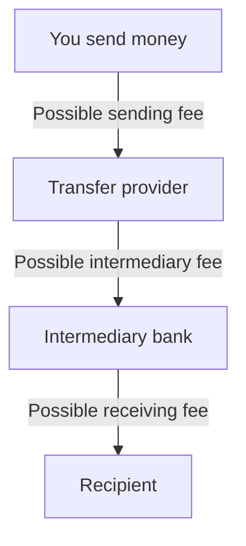

# Transfer route guidance

Add a Markdown file in `content/routes/` for any route that needs extra guidance. Use the sending and receiving country codes from `src/transfer.js` in the filename, in that order. For example, `US-GB.md` applies when sending from the United States to the United Kingdom; `GB-US.md` is a different route.

To share guidance across routes that use the same currencies, use the currency codes instead, such as `SEK-EUR.md`. A country-specific file takes precedence over a currency-pair file when both match.

Write regular Markdown headings and bullet lists. An optional Mermaid diagram can show where a fee may be applied or deducted:

Keep statements route-specific, label uncertain fees as possible, and include links to reliable sources and a last-reviewed date when available. The tool shows its general checklist when there is no matching route file.

After editing or adding a file, run `npm run dev` to preview it. Pushing the change to `main` builds and publishes the updated guide through GitHub Pages.
