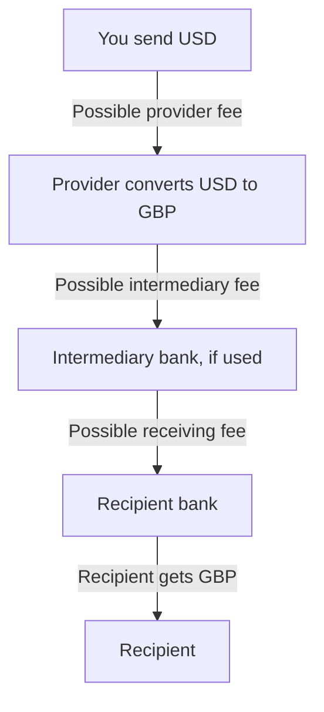

## Before confirming

- Compare the recipient's final amount after the exchange rate and all quoted fees.
- Check whether the provider fee is paid separately or deducted from the amount sent.
- Ask whether an intermediary or receiving bank may deduct a fee.
- Confirm the delivery estimate and whether it depends on the payment method.
- Test

## Illustrative fee path

Fees and payment paths vary by provider. This diagram shows possible fee points, not charges that apply to every transfer.

